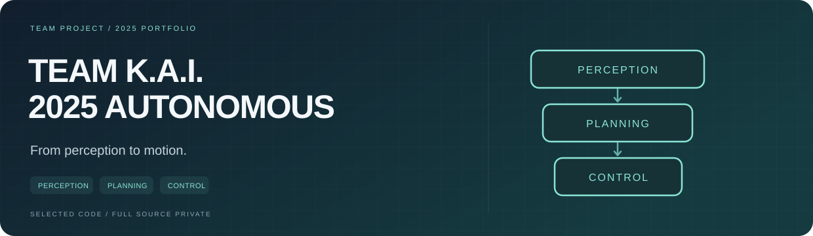

<p></p>

# Team K.A.I. · 2025 Autonomous Driving

**인지에서 판단, 실제 차량 제어까지. 건국대학교 Team K.A.I.의 2025 자작자율차 프로젝트입니다.**

2025년 11월 3일을 기준으로 팀의 인지·판단·제어와 통합 자료를 정리했습니다. 전체 원본은 7개 저장소의 32개 브랜치 참조를 모아 별도로 보관하고, 이곳에는 **프로젝트 구성·사용 기술·공개용 축약 코드**를 담았습니다.

> **전체 원본 저장소와 대회용 구현·설정은 대회 준비를 위해 비공개입니다. 2026 진행 중인 프로젝트의 원본도 공개하지 않습니다.**

`ROS 2 Humble` `C++` `Python` `Camera · LiDAR` `RTK / INS` `Path Planning` `CAN · Serial` `Arduino VCU`

[프로젝트 구성](#프로젝트-구성) &nbsp; / &nbsp; [선별 코드](#선별-코드) &nbsp; / &nbsp; [기술과 역할](SKILLS.md) &nbsp; / &nbsp; [개인 프로필](https://github.com/subin11111)

## 2025 시즌

| 구분 | 내용 |
| --- | --- |
| **팀** | 건국대학교 Team K.A.I. 자율주행팀 |
| **개인 역할** | **제어파트 · 회장단 총무** |
| **성과** | 2025 대학생 창작 모빌리티 경진대회 자작자율차 부문 **창작기술 우수상(1위) · 자율주행성능 특별상** |
| **정리 기준** | 2025-11-03 23:59:59 KST 이전 자료 |

팀 전체가 개발한 시스템을 소개하며, 인지·판단 구현을 개인 단독 성과로 표기하지 않습니다. 제 개인 참여 영역은 **차량 제어와 팀 운영**입니다.

## 프로젝트 구성

| 단계 | 팀 시스템의 개발 내용 | 사용 기술 |
| --- | --- | --- |
| **01 · Perception** | 카메라·LiDAR 기반 콘 검출, 센서 보정·추적, RTK / INS 위치 정보 | ROS 2 · C++ · Python · PCL · YOLO · OpenPCDet / VoxelNeXt |
| **02 · Planning** | 전역·로컬 경로, 콘 라벨링, 속도 계획과 경로 추종 | ROS 2 · 경로 기하 · Pure Pursuit · RViz |
| **03 · Control** | 구동·조향, VCU 연동, 수동·자율 모드와 상태 피드백 | C++ · Python · Arduino Mega · CAN · Serial |
| **04 · Integration** | 파트 간 메시지·실행 구성, 대시보드·주행 관측과 운용 문서 | ROS 2 launch · 사용자 정의 메시지 · RViz |

### Perception → Planning → Control

```text
Camera · LiDAR · RTK / INS
             ↓
   검출 · 추적 · 위치 추정
             ↓
   경로 생성 · 속도 계획 · 추종
             ↓
   명령 선택 · 구동 · 조향
             ↓
       VCU · CAN · Motors
```

각 파트의 역할을 설명한 기능별 개요입니다. 대회용 연결 규약과 내부 설정은 비공개로 관리합니다.

## 선별 코드

<table><tr>
<td width="33%" valign="top"><b>01 · PERCEPTION</b><br><sub>검출 중심점 선택·정렬</sub><br><a href="examples/perception/valid_cones.py">인지 예제 →</a></td>
<td width="33%" valign="top"><b>02 · PLANNING</b><br><sub>목표점과 추종 기하</sub><br><a href="examples/planning/lookahead.py">판단·추종 예제 →</a></td>
<td width="33%" valign="top"><b>03 · CONTROL</b><br><sub>정지 우선과 명령 선택</sub><br><a href="examples/control/command_mux.py">제어 예제 →</a></td>
</tr></table>


원본에서 설명할 부분만 골라 **독립 실행 가능한 Python 예제로 축약·재작성**했습니다. 아래 코드는 표준적인 계산·상태 처리만 보여주며 실제 대회 시스템의 소스, 성능 또는 완주 재현물이 아닙니다.

| 파트 | 공개 예제 | 보여주는 내용 |
| --- | --- | --- |
| **인지** | [valid_cones.py](examples/perception/valid_cones.py) | 유효한 검출 중심을 추려 전방 거리순으로 정렬 |
| **판단·추종** | [lookahead.py](examples/planning/lookahead.py) | 전방 목표점 선택과 일반적인 Pure Pursuit 기하 계산 |
| **제어** | [command_mux.py](examples/control/command_mux.py) | 정지 상태 우선·수동/자율 명령 선택의 기본 흐름 |

**[예제 실행과 원본 대응 설명 →](examples/README.md)**

공개 예제에는 실차 통신·펌웨어, 차량 식별자·프레임, 대회별 튜닝·판단 전략, 실제 위치·경로·센서 보정값, 모델 가중치·데이터 및 계정·비밀번호가 포함되지 않습니다. 예제 입력은 모두 설명용으로 만든 값입니다.

## 기술과 개인 기여

**제어파트:** Arduino VCU–ROS 2 연결, 구동·조향 명령과 CAN·시리얼 통신, 수동/자율 모드 및 차량 상태 관측을 다뤘습니다. **회장단 총무:** 팀 운영에 참여했습니다.

인지·판단은 팀 시스템의 전체 맥락과 파트 간 협업을 설명하기 위해 함께 정리했습니다. 기술별 구분은 **[SKILLS.md](SKILLS.md)**에서 볼 수 있습니다.

## 자료 범위와 출처

TeamKAI-DL의 `Control`, `Planning`, `Perception_25`, `pcdet_voxelnext`, `KAI`, `.github`, `.github-private` 중 기준일 이전에 접근 가능한 자료를 정리했습니다. 현재 남아 있는 브랜치 이력에서 기준일 이전 커밋을 선택했으므로, 당시 삭제된 자료까지 모두 복원했다는 의미는 아닙니다.

전체 원본은 비공개 보관본에 있으며, 공개 저장소에는 과거 Git 이력이나 원본 스냅샷 브랜치를 올리지 않습니다. 원본의 민감한 접속 기본값도 빈 문자열로 바꾸었습니다. 자세한 공개 범위와 예제 출처는 [PUBLICATION.md](PUBLICATION.md)에 기록했습니다.
